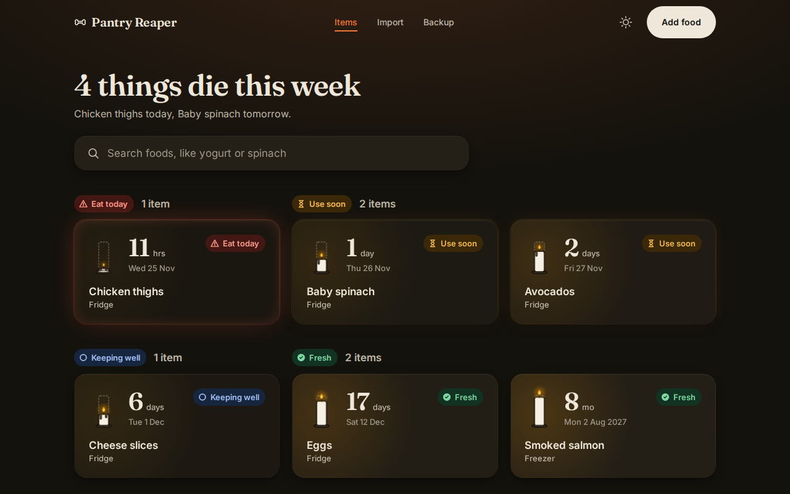
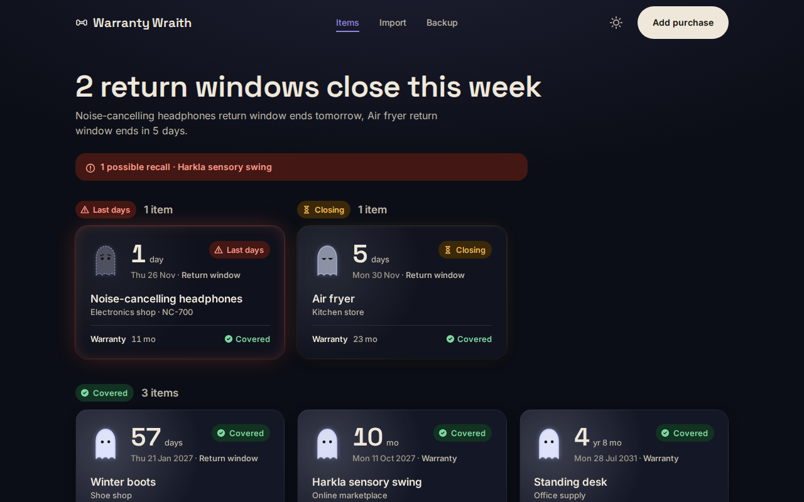
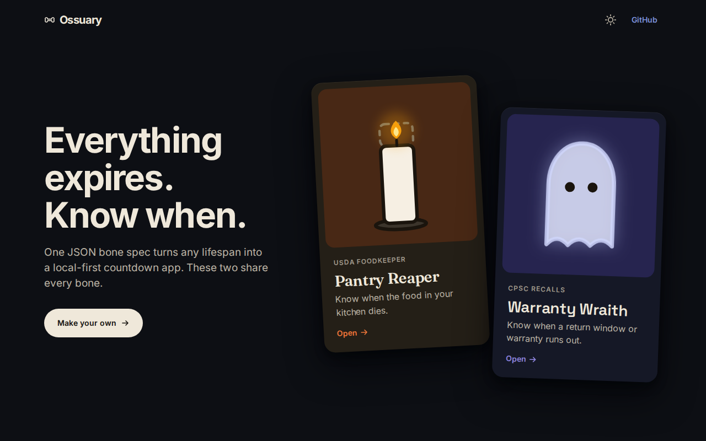
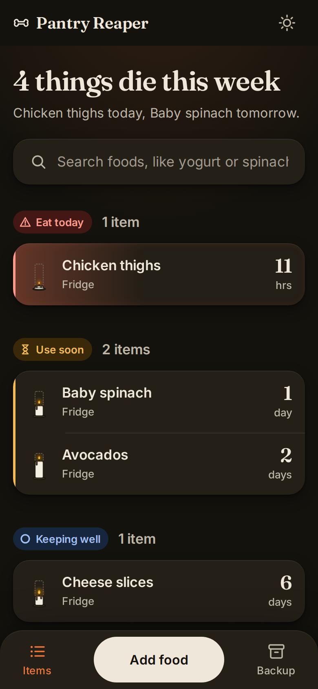
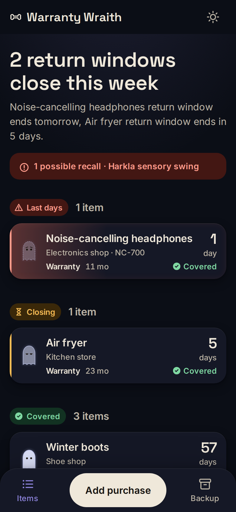

# Ossuary

One skeleton for anything that expires. Describe a lifespan in one JSON file, a **bone spec**, and get a
local-first countdown app. Two different apps built on it show that the skeleton is reusable.

Built for [Kiroween 2026](https://kiroween.devpost.com/), category Skeleton Crew.

| Pantry Reaper | Warranty Wraith |
|---|---|
|  |  |

<p>
  
  
  
</p>

Both apps open in a dark theme we call the crypt: a near-black stone background tinted with the app's own colour
(warm soot for Pantry Reaper, blue night for Warranty Wraith) and bone-white text. You can see decay from across
the room. A candle burns down to a stub and leaves a dashed outline where the wax used to be. A ghost fades into the
background as its time runs out. Anything that dies today gets an ember glow, and dead items become dashed outlines
of a card. On first load the candles burn down from full height and the ghosts fade in.

The first visit adds a few sample items so there is something to look at (the toast has a "Clear" button). The sun
button in the top bar switches to the old light theme and remembers it. With reduced motion turned on you get the
same end states and nothing moves. The dark colours are worked out from each spec's light theme by `cryptTheme` in
`packages/ossuary-core/src/ui/crypt.ts`, so a third app gets its own crypt without extra work. A unit test checks
every theme against WCAG AA in both modes.

## What it is

`packages/ossuary-core` is the skeleton. It has no domain knowledge: a boundary check (a Kiro hook and a test)
fails if it ever says "food", "warranty" or a similar word. It holds:

- Bone spec schema (zod 4). It validates a spec and reports every problem as `path: message`. It also rejects
  theme colours below 4.5:1 contrast. The schema is exported as JSON Schema in `bone-spec.schema.json`.
- Lifespan engine: It is pure and deterministic, and time is always passed in as an argument. It turns a spec
  and an item into an expiry day, the days left, a stage, and a trace that explains every rule ("why this date").
  The core suite runs under three time zones.
- Local store: IndexedDB via `idb`. It also handles CSV import (column mapping, preview, a 5 MB and
  10,000-row cap) and JSON backup and restore.
- Calendar export: A hand-written iCalendar writer: one all-day event per lifespan, with a reminder when each
  stage with a threshold begins.
- UI: Plain web components (`oss-shell`, `oss-list`, `oss-item`, `oss-sheet`, `oss-field`, `oss-trace`,
  `oss-decay`, `oss-import`, `oss-toast` and more) and the design tokens from `design/DESIGN.md`. Each spec sets its
  own accent, display font and decay motif (candle, ghost or hourglass).
- Offline: A Vite plugin builds a service worker that precaches every built file, so the app works with no
  network after the first visit.

A live gallery of every component in every state runs with `bun run dev:gallery`.

## The two apps

Pantry Reaper (`apps/pantry-reaper`) counts down food. Search 640 foods from a USDA FoodKeeper snapshot ("yogurt",
"spinach"), and its shelf life fills in for pantry, fridge or freezer. Switch storage later and the date moves
("Moved to freezer: +N days", with undo). Items burn down like a candle. Mark one "Used it" when it's gone.

Warranty Wraith (`apps/warranty-wraith`) tracks two clocks per purchase: the return window and the warranty.
It checks each item's name and model against a snapshot of 264 US CPSC recalls. A possible match shows a "Possible
recall match" banner with a link to the notice and a "Not my model" button that hides it. Purchases fade like a
ghost.

Both apps give you:

- a list grouped by stage
- add and edit sheets generated from the spec
- a detail view with the trace
- "Add to calendar" (.ics)
- CSV import
- JSON backup and restore
- undo on removal

Neither app has accounts or makes any network call after load. Their only code is thin glue plus their data.

Launcher (`apps/launcher`) is the landing page. It has one card per app, built from each app's `bone.json`.

## Run it

You need [bun](https://bun.sh) and Node. Tested with bun 1.4.2 and Node 24.

```sh
bunx pnpm@10 install           # install the workspace (pnpm 10, from the lockfile)
bun run playwright:install     # once, for the e2e tests: Chromium for Playwright
```

| Command | What it does |
|---|---|
| `bun run dev` / `bun run dev:pantry` | Pantry Reaper on http://localhost:5173 |
| `bun run dev:wraith` | Warranty Wraith on http://localhost:5174 |
| `bun run dev:gallery` | Core component gallery on http://localhost:5180 |
| `bun run build` | Launcher and both apps into one static `dist/` (apps under `/pantry-reaper/` and `/warranty-wraith/`) |
| `bun run preview` | Serves `dist/` on http://localhost:4180 |
| `bun run build:pantry`, `bun run build:wraith` | One app into `apps/<app>/dist` |
| `bun run preview:pantry`, `bun run preview:wraith` | That build on port 4173 or 4174 |
| `bun run test` | Whole vitest suite, then the core suite again under UTC, America/New_York and Pacific/Auckland |
| `bun run test:one <path>` | vitest on one file or folder |
| `bun run typecheck` | `tsc -b` over every package, app, tool, the bone-forge template and the scripts |
| `bun run e2e` | Playwright: both apps, offline runs, accessibility, the gallery and the launcher. It starts its own servers. |
| `bun run hook:boundary` | Core boundary check (see Kiro hooks below) |
| `bun run hook:spec [file ...]` | Validates bone specs, by default every `apps/*/bone.json` |
| `bun run hook:engine` | Engine and schema unit tests only |
| `bun run bone-forge` | Starts the bone-forge MCP server on stdio |
| `bun run data:pantry`, `bun run data:wraith` | Rebuild app data from the committed raw snapshots |

The full gate is `bun run test`, `bun run typecheck`, `bun run e2e`, `bun run hook:boundary` and
`bun run hook:spec`. To run it in a clean container:

```sh
docker build -t ossuary-gate .
docker run --rm --ipc=host ossuary-gate
```

## The bone spec

An app is a `bone.json`:

```json
{
  "id": "library-lich",
  "name": "Library Lich",
  "version": 1,
  "entity": {
    "titleField": "title",
    "fields": [
      { "key": "title", "kind": "text", "label": "Book", "required": true },
      { "key": "borrowed", "kind": "date", "label": "Borrowed on", "required": true }
    ]
  },
  "lifespans": [
    {
      "id": "loan",
      "label": "Loan",
      "startField": "borrowed",
      "base": { "type": "duration", "amount": 21, "unit": "day" },
      "stages": [
        { "id": "on_loan", "label": "On loan", "tone": "fresh" },
        { "id": "due_soon", "label": "Due soon", "tone": "soon", "enterAtDays": 3 },
        { "id": "overdue", "label": "Overdue", "tone": "dead" }
      ]
    }
  ]
}
```

- **entity.fields**: `text`, `number`, `date` or `enum`, with labels, `required` and `hidden`. They generate the add
  and edit sheet.
- **lifespans**: one or more countdowns per item.
  - Each has a `base`: either a `duration` (optionally read from a number field with `amountField`) or a date
    `field`.
  - Rules then `extend`, `shorten`, `clamp` or `lookup` (a table keyed by a field's value) the base, optionally
    `when` a field equals a value.
- **stages**: the first stage has no threshold. The ones after it enter at a falling `enterAtDays`, and the last one
  has the `dead` tone. Each stage maps to one of five tone slots (fresh, steady, soon, urgent, dead), whose
  colours the core owns.
- theme (optional): accent colours, canvas, display font, motif, empty-state art and wordmark. Contrast is
  checked.
- copy and **sources** (optional): empty-state text, the add button label, and data sources with their
  licences.

Pantry Reaper and Warranty Wraith are both complete examples (`apps/*/bone.json`).

## bone-forge (MCP server)

`tools/bone-forge` is a stdio MCP server built on `@modelcontextprotocol/sdk`. It is a thin layer over the core
and has three tools:

- `validate_spec`: returns `{ valid, issues }` for a spec given as an object or JSON text. It never throws.
- `preview_countdown`: runs the engine on one example item for a given day and returns every lifespan with its
  expiry, stage and trace.
- `scaffold_app`: writes a new `apps/<name>` from a valid spec (11 files, create-only, never overwrites) and
  prints the remaining wiring steps.

Kiro picks it up from `.kiro/settings/mcp.json`. `validate_spec` and `preview_countdown` are auto-approved.
`scaffold_app` asks first, because it writes files.

To make your own app in about 10 minutes, see [docs/REMIX.md](docs/REMIX.md).

## How Kiro was used

Everything in `.kiro/` was written with Kiro (kiro-cli) and is committed, as the hackathon requires.

- Steering (`.kiro/steering/`): `product.md` (pitch, components, the no-domain-words rule), `tech.md` (stack and
  engineering rules: pure engine, tests first, local-first, validate at boundaries) and `structure.md` (the
  monorepo layout and the dependency direction). All three are always included.
- Specs (`.kiro/specs/`): each has a requirements, design and tasks file. Every task starts with a failing
  test.
  - `skeleton-contract`: the bone spec, engine, store and calendar export.
  - `app-pantry-reaper` and `app-warranty-wraith`.
  - `bone-forge`.
  - `launcher`.
  - `a11y-motion`.
- Hooks (`.kiro/hooks/`):
  - Saving any file in `packages/ossuary-core` runs `bun run hook:boundary`. It fails if the core imports an app or
    tool, uses `Date` or the DOM in its pure layers, or contains a domain word.
  - Saving a core `.ts` file runs `bun run hook:engine`.
  - Saving an `apps/*/bone.json` runs `bun run hook:spec`.
- MCP (`.kiro/settings/mcp.json`): registers bone-forge, so Kiro can validate specs, preview countdowns and
  scaffold apps in chat.

## Accessibility and offline

- Every screen of both apps, the launcher and the gallery is checked with axe in the e2e suite, at desktop and
  phone sizes.
- Under `prefers-reduced-motion`, motion is off (all duration tokens drop to 0). The e2e suite tests this too.
- Status always pairs colour with a word and a glyph. The decay art is decorative (`aria-hidden`), and the number
  and stage pill next to it carry the meaning.
- Interactive targets are at least 44x44 px (checked in the gallery e2e). The schema contrast-checks theme colours.
- The production build registers a service worker that precaches the whole app, data included. Offline e2e tests
  load each app, go offline, reload and keep working.
- A network guard in each app's e2e tests records every request from the page and its service worker. A test fails
  if any request leaves the machine.

## Data and licences

- USDA FoodKeeper (Pantry Reaper): US Department of Agriculture, Food Safety and Inspection Service. It is a
  public domain US government work, listed as CC0 1.0 on data.gov. Snapshot retrieved 2026-11-17.
  - Details are in `apps/pantry-reaper/SOURCE.md`.
  - Shelf life is guidance, not a safety guarantee.
- CPSC Recalls (Warranty Wraith): US Consumer Product Safety Commission, via the SaferProducts.gov Recalls API.
  It is a public domain US government work (17 U.S.C. § 105). Snapshot of recalls from 2026-06-04 to 2026-11-12.
  - Credit: US Consumer Product Safety Commission. This app is not endorsed by CPSC, and it uses no recall
    photographs.
  - A match is a possible match to check against the notice. Details are in `apps/warranty-wraith/SOURCE.md`.
- **Fonts**: Inter, Fraunces and Space Grotesk, under the SIL Open Font License, self-hosted through
  `@fontsource-variable`.

Both data snapshots are committed. Nothing fetches them at build, test or run time.

## Licence

MIT, see [LICENSE](LICENSE).
